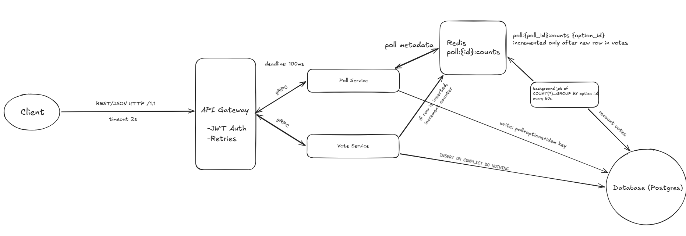
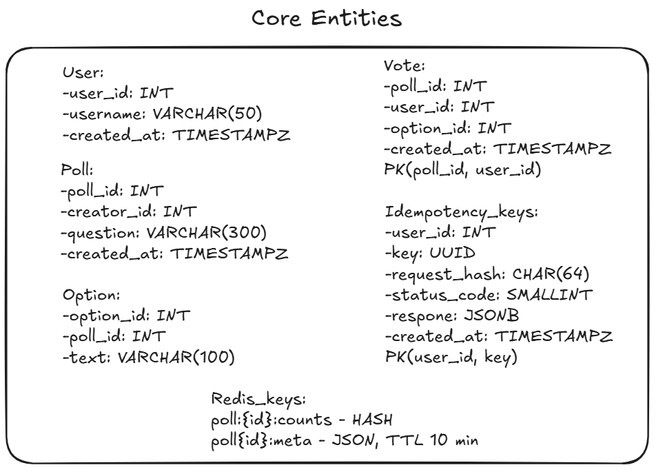
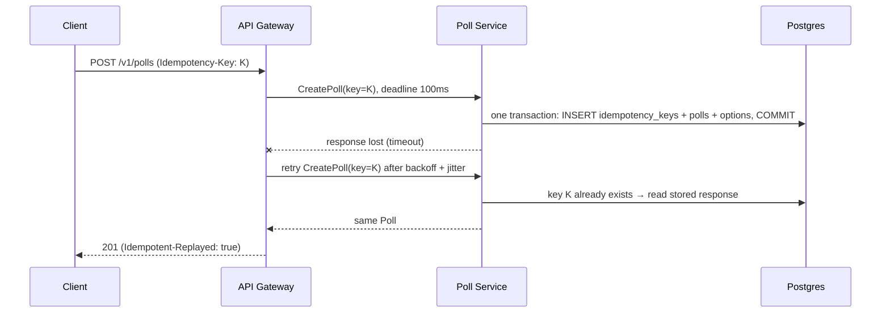
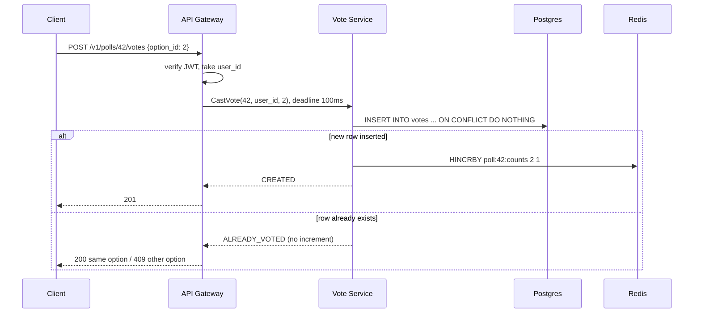
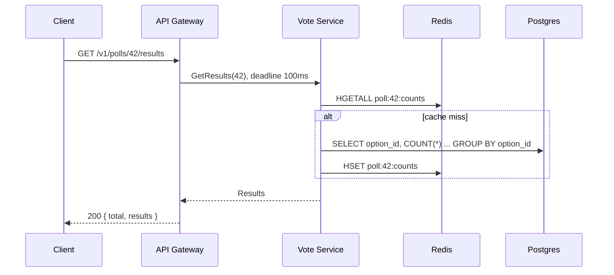

# Polls & Voting

A service that lets users create polls, vote once per poll, and view results.

## Requirements

**Functional**
1. Create a poll with a question and options
2. A user can vote in a poll, only once per poll
3. View results

**Non-functional**
1. Vote writes: 3000 RPS at peak
2. 100k active polls
3. Latency p99 < 100 ms for vote and view

## Architecture



`poll:{poll_id}:counts {option_id}` is incremented only after a new row is inserted into `votes`, so a retried vote never counts twice.

## Core entities




## API

Public API is REST/JSON. Internal calls (Gateway -> services) use gRPC.

```
POST /v1/polls
Authorization: Bearer <JWT>
Idempotency-Key: <uuid>
{ "question": "best number?", "options": ["1", "2", ...] }
→ 201 { "poll_id", "question", "options": [{ "option_id", "text" }] }

GET /v1/polls/{poll_id}
→ 200 { "poll_id", "question", "options": [...] }

POST /v1/polls/{poll_id}/votes
Authorization: Bearer <JWT>
{ "option_id": 2 }
→ 201 first vote | 200 same vote retried | 409 already voted for another option

GET /v1/polls/{poll_id}/results
→ 200 { "poll_id": 123, "total": 1530, "results": [{ "option_id": 1, "count": 900 }, ...] }
```

## Flows

### Create poll (with retry)



### Vote



### Results



## How to run

```bash
docker compose up --build -d          # postgres, redis, poll-service, vote-service, gateway
curl "localhost:8080/dev/token?user_id=7"                 # test JWT
curl -X POST localhost:8080/v1/polls -H "Authorization: Bearer <token>" \
     -H "Idempotency-Key: $(uuidgen)" -H "Content-Type: application/json" \
     -d '{"question":"best number?","options":["1","2","3"]}'
curl -X POST localhost:8080/v1/polls/1/votes -H "Authorization: Bearer <token>" \
     -H "Content-Type: application/json" -d '{"option_id":2}'
curl localhost:8080/v1/polls/1/results
docker compose down                   # stop (data is not kept)
```

| Module | What it is |
|---|---|
| [api](api/) | `polls.proto` (gRPC contract) + the same fields as JSON DTOs + shared error codes |
| [service-common](service-common/) | gRPC server, deadline reading, DB error mapping |
| [poll-service](poll-service/) | CreatePoll (idempotency key), GetPoll (Redis cache), ListPolls |
| [vote-service](vote-service/) | CastVote (`ON CONFLICT DO NOTHING` + `HINCRBY`), GetResults, counter reconciler |
| [gateway](gateway/) | public REST, JWT, deadline budget, retries, metrics; internal protocol switchable `grpc`/`rest` |

Each service exposes the **same operations twice**: gRPC (HTTP/2) and REST/JSON (HTTP/1.1), so they can be compared.
Switch the gateway's internal protocol and the resilience settings at runtime:

```bash
curl localhost:8080/admin/settings
curl -X PUT localhost:8080/admin/settings -H "Content-Type: application/json" -d '{"protocol":"rest","deadline_ms":100,"attempt_timeout_ms":0,"max_attempts":3,"base_backoff_ms":10,"max_backoff_ms":50,"jitter":true,"retry_on_deadline":false}'
```

**Monitoring:** Grafana at http://localhost:3000 (dashboard "Polls & Voting", no login), Prometheus at http://localhost:9090.

**Load tests and experiments** (needs [k6](https://k6.io)): `bash loadtest/run-all.sh` runs all of them (~20 min) and writes `results/summary.md`. Results and analysis: [REPORT.md](REPORT.md).

```bash
k6 run -e MODE=grpc -e OP=vote -e RATE=1000 loadtest/bench.js      # one run: MODE=grpc|rest|gateway, OP=vote|results|list
curl -X PUT localhost:8092/admin/chaos -H "Content-Type: application/json" \
     -d '{"latency_ms":150,"latency_rate":0.05,"fail_rate":0.1,"fail_after_rate":0}'   # inject faults into vote-service
```

Raw metrics: `localhost:8080/actuator/prometheus` (`gateway_backend_call_seconds`, `gateway_backend_attempt_seconds`, `gateway_backend_retries_total`, `gateway_backend_payload_bytes`).
